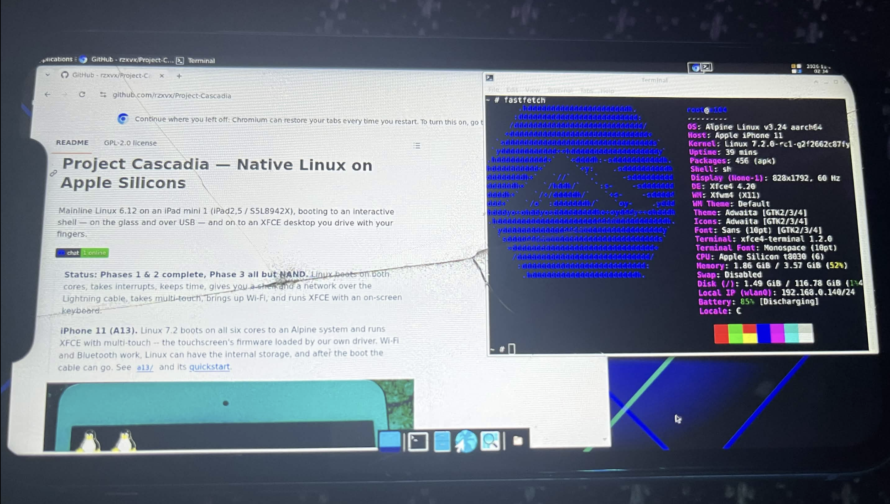
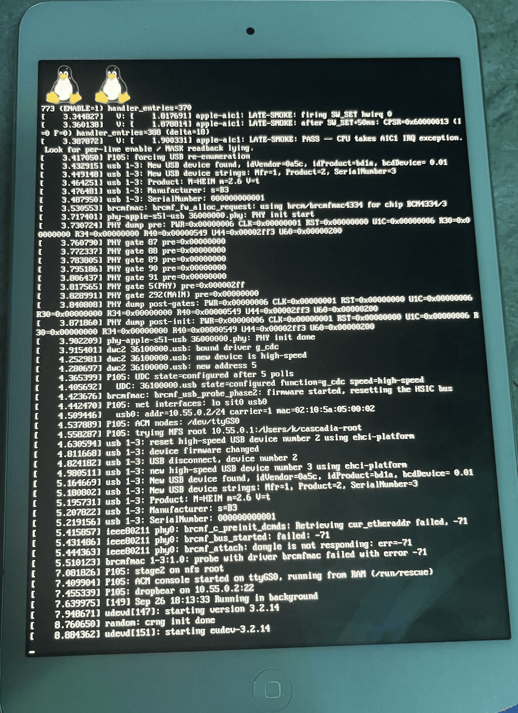
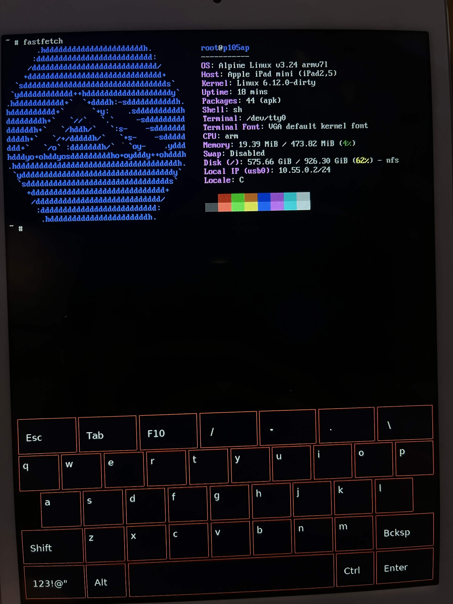
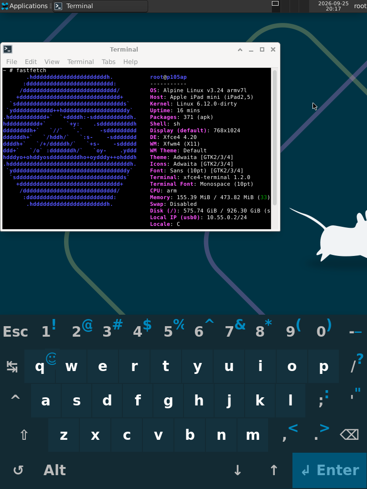

# Project Cascadia — Native Linux on Apple Silicons

Mainline Linux on Apple's own phones and tablets, booted from your computer
over USB: a shell on the glass and over the cable, Wi-Fi, multi-touch, and an
XFCE desktop you drive with your fingers.





## Devices

| Device | Model | Chip | What works | Start here |
|---|---|---|---|---|
| iPad mini 1 (Wi-Fi) | iPad2,5 / A1432 / p105ap | Apple A5 (S5L8942X) | Linux 6.12: both cores, touch, Wi-Fi, Bluetooth, speakers, battery, the GPU (OpenGL ES 2.0 / GL 2.1), XFCE; iOS's files read-only | [devices/a5](devices/a5/README.md) · [quickstart](devices/a5/docs/QUICKSTART.md) |
| iPhone 11 | iPhone12,1 / n104ap | Apple A13 (T8030) | Linux 7.2: all six cores, touch, Wi-Fi, Bluetooth, XFCE, the internal storage as Linux's disk, no cable after the boot | [devices/a13](devices/a13/README.md) · [quickstart](devices/a13/docs/QUICKSTART.md) |

Experimental: the iPad 2 Wi-Fi (iPad2,1 / K93AP, S5L8940) boots Linux 6.12 to
a RAM-only USB shell from the A5 tree — see
[K93 bring-up and limitations](devices/a5/docs/k93-bringup.md).

## Using it

One command for every device, from the repository's top:

```bash
git clone https://github.com/rzxvx/Project-Cascadia.git
cd Project-Cascadia
./cascadia a5 install         # iPad mini 1: everything, step by step
./cascadia a13 doctor         # iPhone 11: what this machine is missing
```

`./cascadia a5 …` and `./cascadia a13 …` are the device's own commands
(`./cascadia a5` alone lists them). The device used last is remembered, so
after the first one a plain `./cascadia build` means the same device again;
`./cascadia device` shows or changes it. The quickstarts above walk through
everything from a clean machine.

## What is this?

Cascadia started as an attempt to run native, mainline Linux on Apple
A5-based devices — beginning with the iPad mini 1 (iPad2,5), where no prior
Linux port existed: postmarketOS covers A8+, Project Sandcastle targeted A10,
and the A5 had been a blind spot. The goal is not just to boot Linux, but to
build a foundation for later chips, documenting everything along the way,
including the parts that did not work. The A13 (iPhone 11) is the second
device.

## Repository layout

```
cascadia        the entry point: ./cascadia <device> <command>
devices/a5/     the A5 tree (iPad mini 1, iPad 2): kernel patches, device
                tree, initramfs, Mesa's GPU driver, tools, docs, research
devices/a13/    the A13 tree (iPhone 11): m1n1 and kernel patches, boot,
                initramfs, Alpine root, tools, docs, research
imgs/           pictures for the READMEs
```

Each device's directory is self-contained, with its own README, quickstart,
roadmap and research notes. Build products and Apple's files stay out of git:
each tree builds into its own `build/`, and the boot chain is derived from an
IPSW (or Apple's CDN) on your machine.

## Roadmap

- **iPad mini 1 (A5)** — phases 1 and 2 done; phase 3 all but NAND as
  Linux's own storage. [devices/a5/README.md](devices/a5/README.md#roadmap)
- **iPhone 11 (A13)** — phases 1 and 2 done; phase 3 up to the internal
  storage; next the native display and the GPU.
  [devices/a13/docs/ROADMAP.md](devices/a13/docs/ROADMAP.md)

### Next devices

In no particular order:
- iPad 6 - A10 (2Gb ram)
- iPad 7 - A10 (3Gb ram)
- iPad Air 2 — A8X
- iPad 4 - A6X
- iPad mini 4 — A8
- iPad 2 - A5
- iPad 3 - A5X
- iPad mini 2 - A7
- iPad mini 3 - A7
- iPad Air 3 - A12 (requires additional hardware for booting - RP2350)
- iPad Pro 10.5" 2017 - A10X
- iPad mini 5 — A12 (requires additional hardware for booting)
- iPad 5 — A9
- iPad 8 - A12 (requires additional hardware)
- iPad 9 - A13 (same T8030 as the iPhone 11; notes in `devices/a13/docs/ipad9/`)





## Support the Research

Project Cascadia is and always will be 100% free, open-source, and licensed under GPL-2.0. 

However, testing low-level code on bare metal carries hardware risks, and further research into later Apple silicon (A6X-A13) requires purchasing additional test devices
If you find this work valuable and wish to support ongoing research, donations are greatly appreciated:


| Asset | Address |
| :--- | :--- |
| 🔵 **Litecoin (LTC)** | `LhxwyrfqN64KTfoS8Y8gAxoRjFp4t4RbCf` |
| 🟠 **Bitcoin (BTC)** | `bc1qmuy5zkkq6lyyg3818quuvjehdwrzes6h96ledt` |
| 🟢 **USDT (TRC-20)** | `0x3Df78641E76C7fDD8258E0e7e4389CFC5e7e6498` |

## Background

In May 2026, while looking for an existing Linux port for the iPad mini 1, I
found nothing. postmarketOS stops at A8, Project Sandcastle targeted A10, and
the A5 had been completely ignored — likely because it's 32-bit, old, and "not
worth it".

That's exactly why it's interesting.

This project started as an experiment to see how far you can get. Turns out —
pretty far.

## Credits

- **teutekeune** — iBSSloader: kernel patches, boot chain, the original AIC1 driver;
  the Tux of the GPU demo (`tux-gpudemo`)
- **axi0mX** — checkm8 BootROM exploit
- **LukeZGD** — Legacy iOS Kit, EverPwnage, checkm8-a5 Pico firmware
- **NyanSatan** — checkm8_bootkit, iBoot research
- **iH8sn0w** — iBoot32Patcher
- **Project Sandcastle** — Z2 multitouch driver and protocol, the starting point

The A13 track's own credits (m1n1, Hoolock, Asahi Linux, usbliter8) are in
[devices/a13/README.md](devices/a13/README.md).

## License

GPL-2.0
