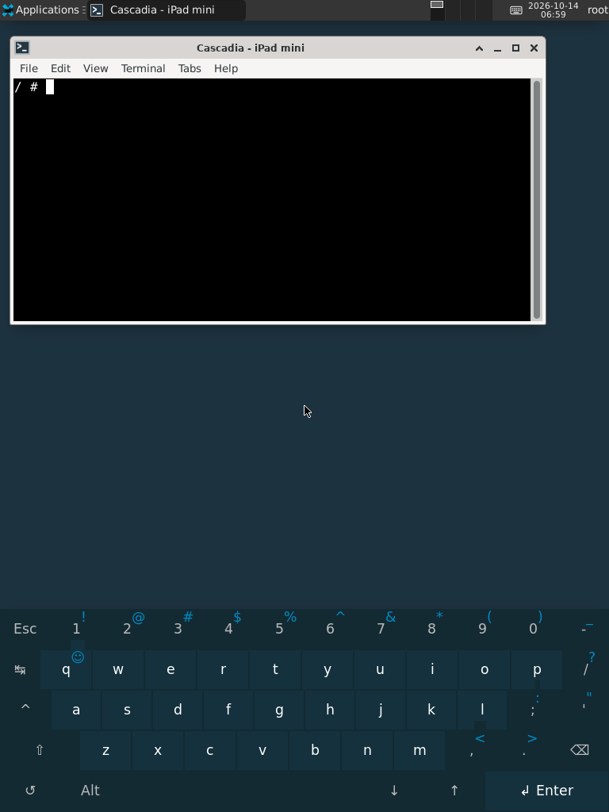

# P105 desktop capture — 14 October 2026

An actual 768 × 1024 framebuffer capture from an iPad mini 1 (P105AP / iPad2,5), taken at 06:59 UTC. The original 32-bit BGRX framebuffer bytes were decoded to RGB PNG; the image is otherwise unaltered. The PNG has no embedded metadata. The visible screen contains no personal account name, device identifier, network credential or key.

The device is running Linux 6.12 from the frozen RAM package built at `1ff01fad8280632fa0a3f25ee9e4cd023a4a0be0`. XFCE, the terminal and svkbd run in a separate Alpine 3.24 armhf NFS chroot; the original root and SSH environment remain in RAM. At capture time a reversible external HDQ module carried the battery-presence error correction equivalent to PR #12. The later explicit-break module was not yet loaded.

This image documents rendered desktop output. It does not establish physical touch operation, charging, usable NAND storage, D-Bus crash recovery, or a boot of the complete newer PR heads. Those qualifications belong to the individual PR test records.

- PNG SHA-256: `65d11c5f61c4b3723bcf58eb8a26070ee44b00d9491a373cf5e7cb8adb79725c`
- Dimensions: 768 × 1024, RGB, 36,975 bytes.
- Relevant PRs: [research overview #8](https://github.com/rzxvx/Project-Cascadia/pull/8), [NFS configuration #11](https://github.com/rzxvx/Project-Cascadia/pull/11), [desktop system-bus readiness #14](https://github.com/rzxvx/Project-Cascadia/pull/14).
