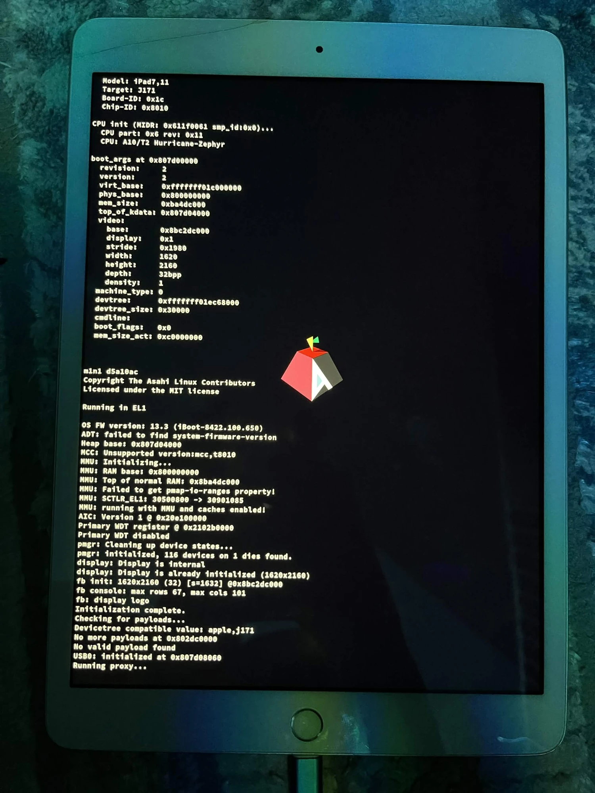
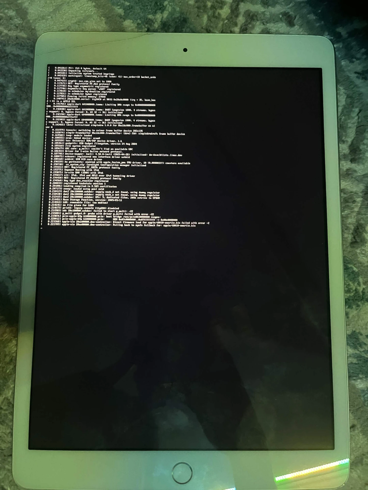
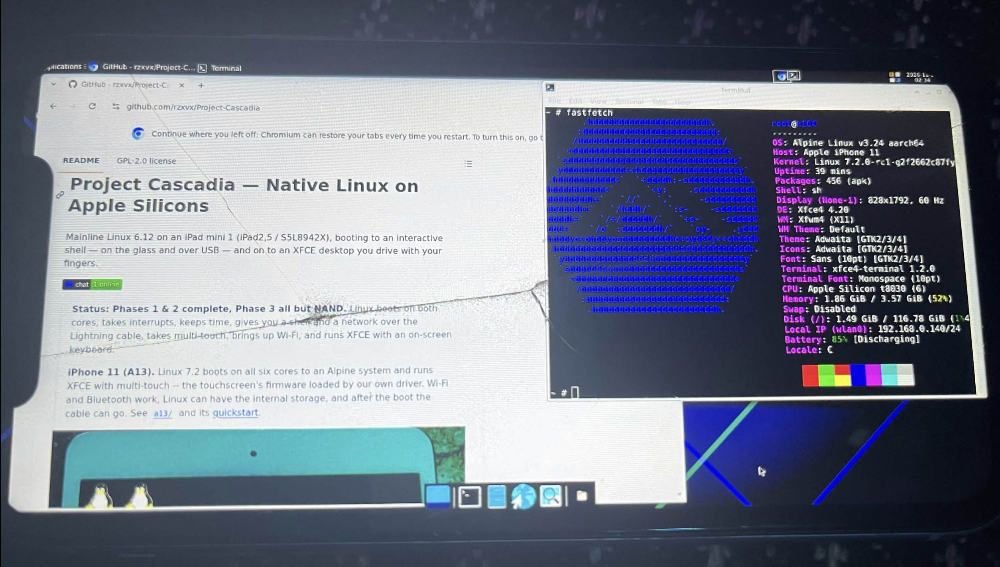
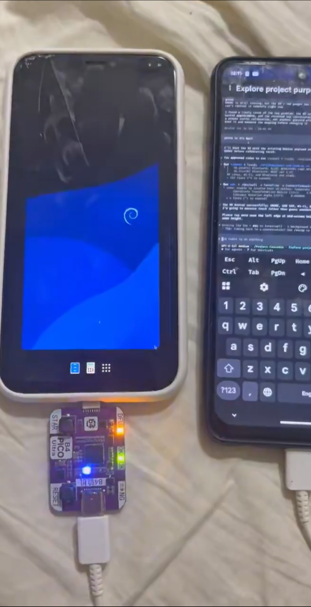
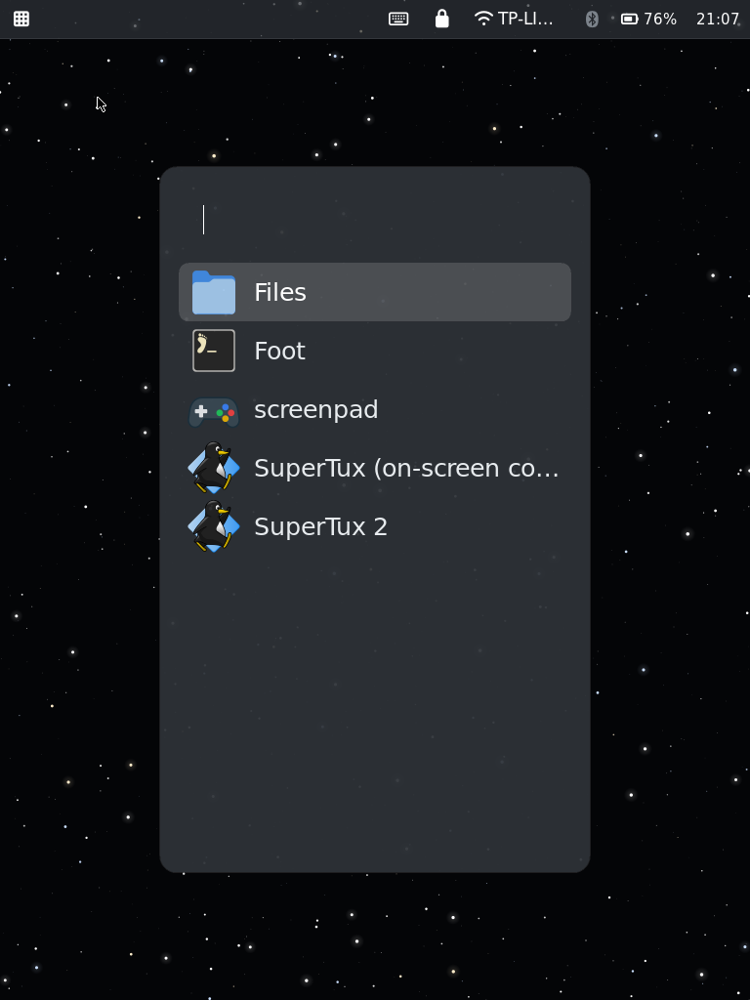
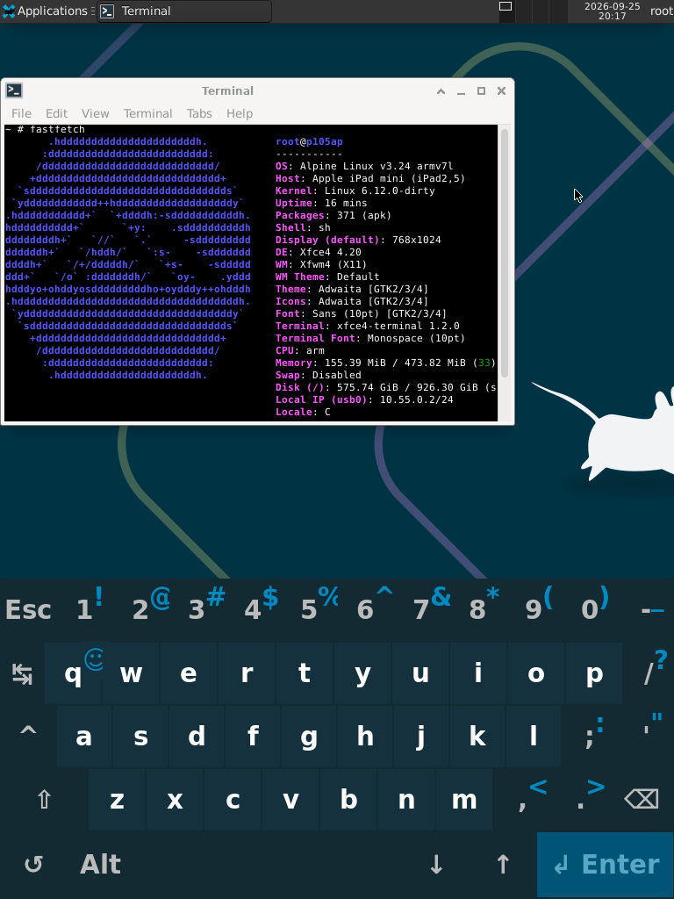
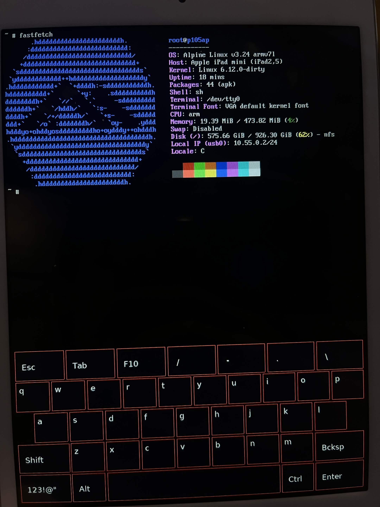
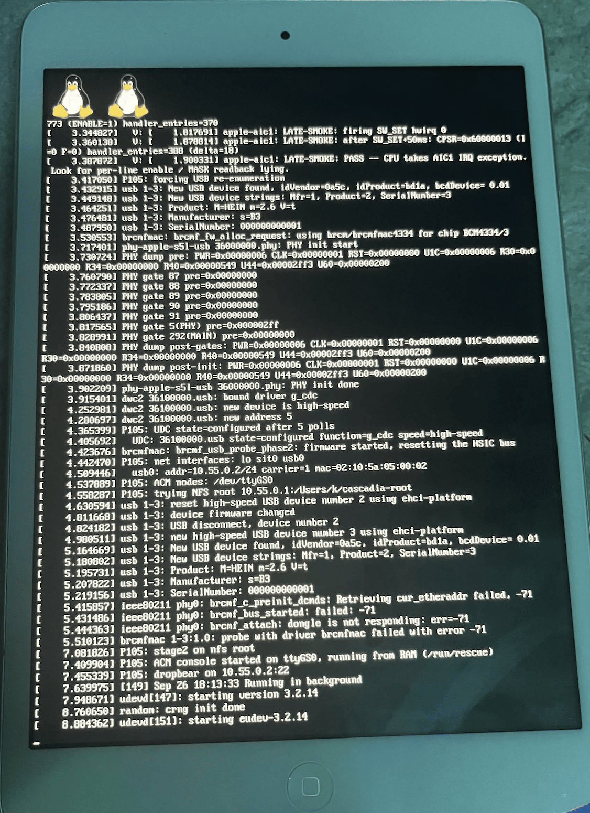
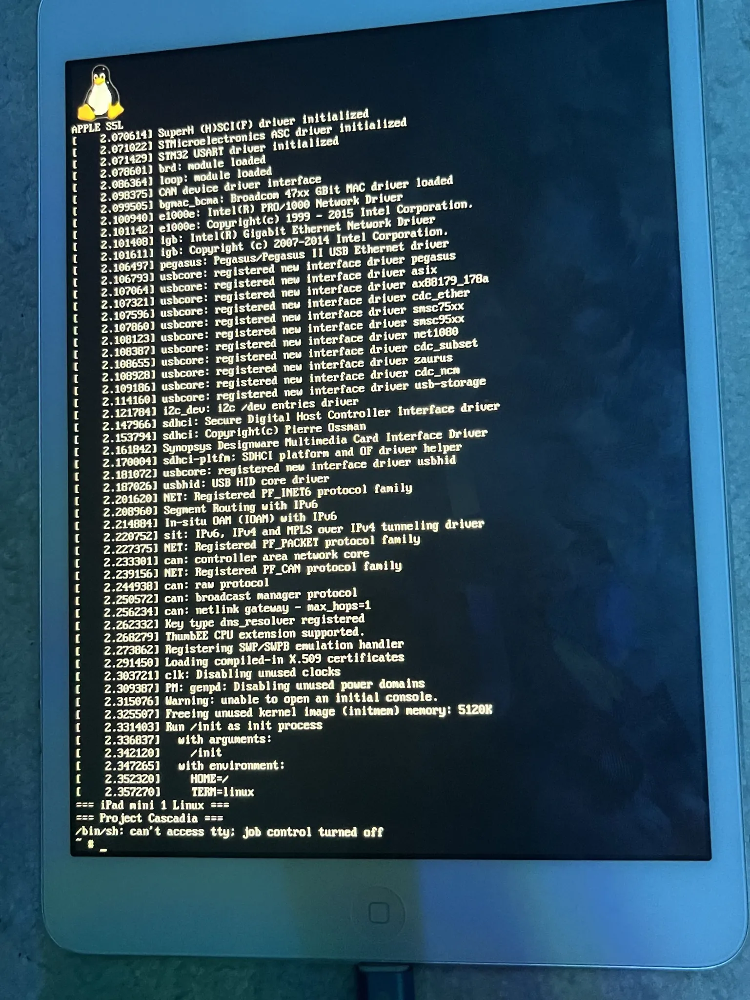
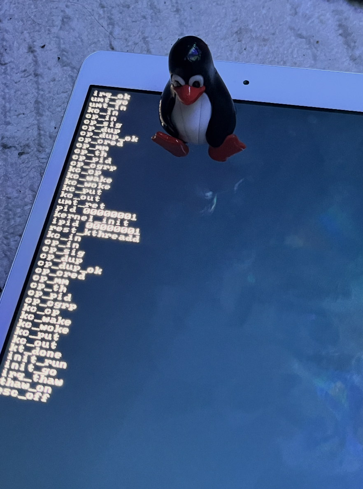

# Gallery

Photos and screenshots of Project Cascadia on each device, newest device
first. The device READMEs link here instead of carrying pictures.

## iPad 7 (A10)

The first boot of the A10 track (2026-11-22): m1n1 on an iPad7,11, started
through the open boot chain (gaster's checkm8, a patched iBSS, no checkra1n).

The first Linux boot from m1n1's proxy: Linux 7.2 on simpledrm, up to the
missing SmartIO firmware.

## iPhone 11 (A13)

## iPhone XR (A12)

## iPad mini 1 (A5)

(HEIC: GitHub shows it only as a download)

